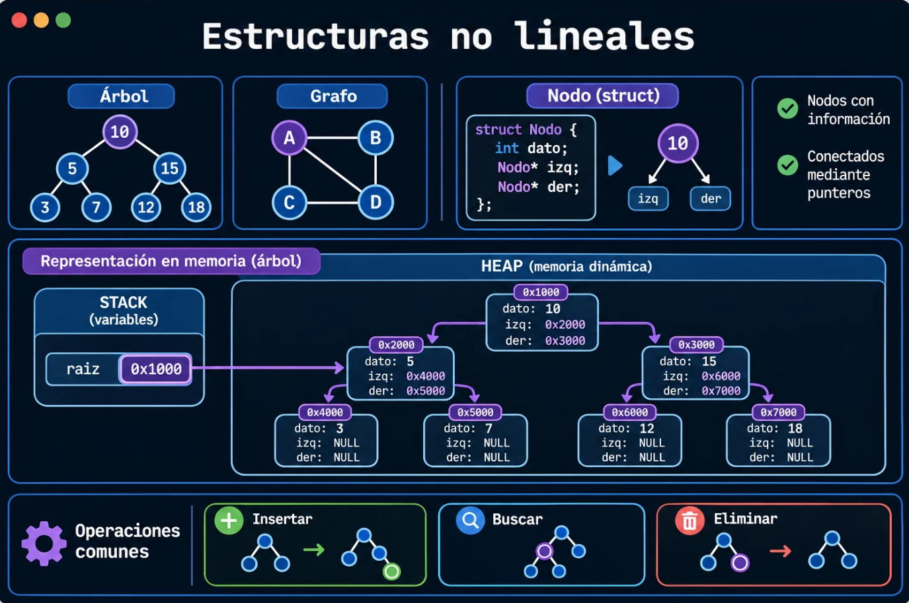
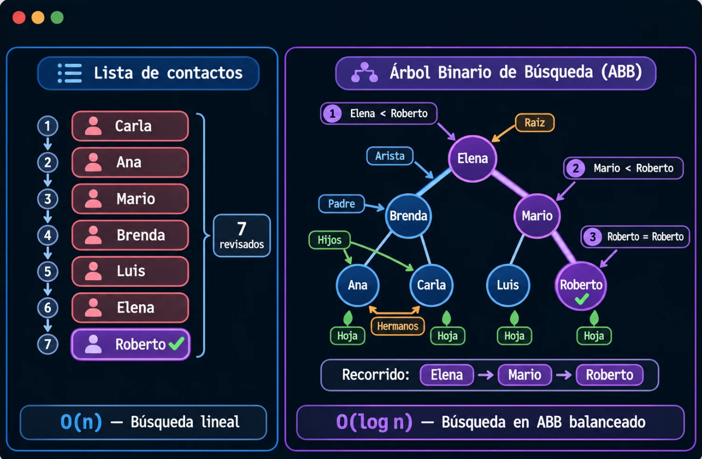
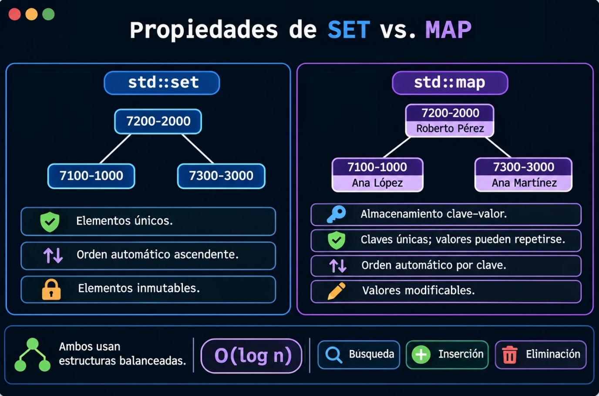

# Guía de laboratorio: Estructuras de Datos No Lineales

## Introducción

Las estructuras de datos no lineales permiten organizar información mediante relaciones jerárquicas o conexiones entre elementos. En esta práctica se estudiarán los árboles binarios de búsqueda y su aplicación mediante los contenedores `std::set` y `std::map` de C++, que facilitan el almacenamiento, la búsqueda y la organización eficiente de datos.

## 1. Estructuras de datos no lineales

Una **estructura de datos no lineal** organiza sus elementos mediante conexiones, en lugar de una secuencia única. Sus componentes se denominan **nodos o vértices**, los cuales almacenan información y establecen relaciones con otros elementos.

Dos ejemplos de estas estructuras son los **árboles** y los **grafos**.

> 💡 El puntero `raiz` puede ser una variable local en el stack, pero el nodo al que apunta se encuentra en el heap cuando se reserva mediante `new`. En un grafo no necesariamente existe una raíz.

### Propiedades

- **Profundidad:** distancia desde la raíz hasta un nodo, medida por el número de aristas.
- **Altura:** longitud del camino más largo desde un nodo hasta una hoja del árbol.

Estas propiedades ayudan a comprender la eficiencia de la búsqueda: mientras más niveles deban recorrerse, mayor puede ser la cantidad de comparaciones necesarias.

> En los grafos también se pueden estudiar distancias respecto a un vértice de referencia, aunque la altura no se define necesariamente de la misma manera que en un árbol.

## 2. Árbol binario de búsqueda (ABB)

Un **árbol binario de búsqueda (ABB)** es una estructura no lineal donde los valores menores que un nodo se ubican en su subárbol izquierdo y los mayores en el derecho.

Esta organización permite descartar partes del árbol durante la búsqueda, reduciendo la cantidad de comparaciones cuando se encuentra balanceado.

### Ejemplo práctico: agenda de contactos

Consideremos una agenda telefónica que almacena nombres de contactos. La información puede organizarse mediante una estructura lineal o un árbol binario de búsqueda.

### Complejidad en la búsqueda y el ordenamiento

En una **lista no ordenada**, la búsqueda puede requerir revisar todos sus elementos, por lo que su complejidad es O(n) en el peor caso.

En un **ABB balanceado**, la búsqueda puede realizarse en O(log n), gracias a que se descartan subárboles en cada comparación. Sin embargo, un ABB desbalanceado puede alcanzar O(n).

Además, un recorrido *inorden* de un ABB permite obtener sus elementos ordenados en O(n), mientras que una lista no ordenada requiere un proceso de ordenamiento adicional.

## 3. Contenedores `std::set` y `std::map` en C++

La Biblioteca Estándar de C++ (STL) ofrece los contenedores `std::set` y `std::map`, que utilizan estructuras de búsqueda balanceadas, comúnmente implementadas mediante un **árbol rojo-negro (Red-Black Tree)**.

Este árbol mantiene su equilibrio mediante reglas de coloración y reorganización de nodos, permitiendo realizar operaciones de búsqueda, inserción y eliminación en **O(log n)**.

Estos contenedores permiten trabajar con estructuras ordenadas sin necesidad de implementar manualmente el árbol ni sus mecanismos de balanceo.

### Comparación entre `std::set` y `std::map`

### Métodos básicos

| Método | Funcionalidad |
|---|---|
| `insert()` | Inserta un elemento nuevo. |
| `find()` | Busca un elemento o una clave. |
| `erase()` | Elimina un elemento o una clave. |
| `size()` | Obtiene la cantidad de elementos. |
| `begin()` / `end()` | Permiten recorrer el contenedor mediante iteradores. |
| `clear()` | Elimina todos los elementos. |

> 💡 En `std::set`, las operaciones utilizan el valor almacenado; en `std::map`, utilizan principalmente la clave.

## 4. Ejemplo

## 5. Enlaces adicionales

- [Visualgo — Binary Search Tree](https://visualgo.net/en/bst): visualización interactiva de las operaciones sobre árboles de búsqueda.
- [Red-Black Tree Visualization — University of San Francisco](https://www.cs.usfca.edu/~galles/visualization/RedBlack.html): permite observar inserciones, eliminaciones y balanceo.
- [GeeksforGeeks — Set en C++](https://www.geeksforgeeks.org/set-in-cpp-stl/): introducción práctica a `std::set`.
- [Programiz — C++ Map](https://www.programiz.com/cpp-programming/map): explicación y ejemplos básicos del uso de `std::map`.
