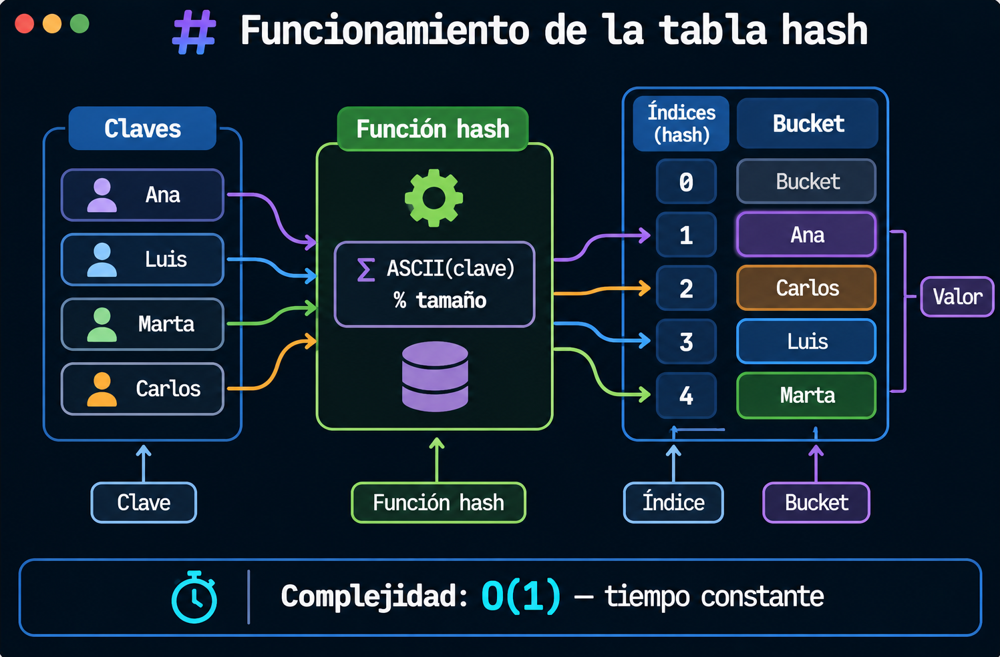
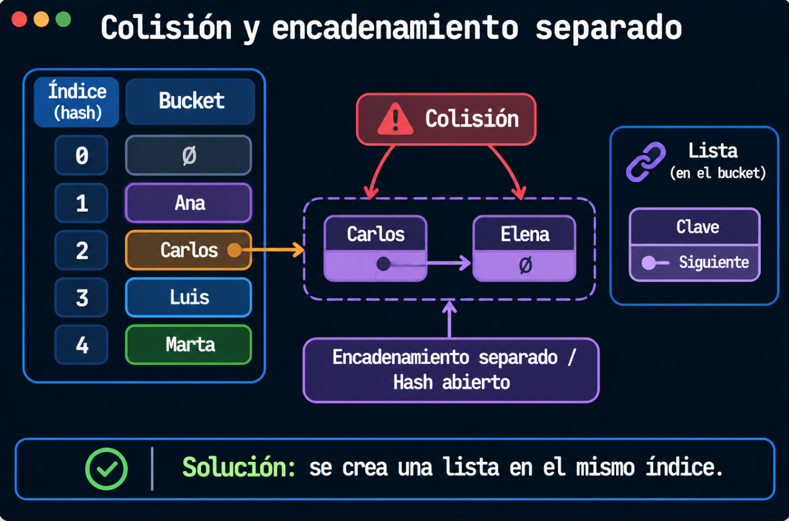
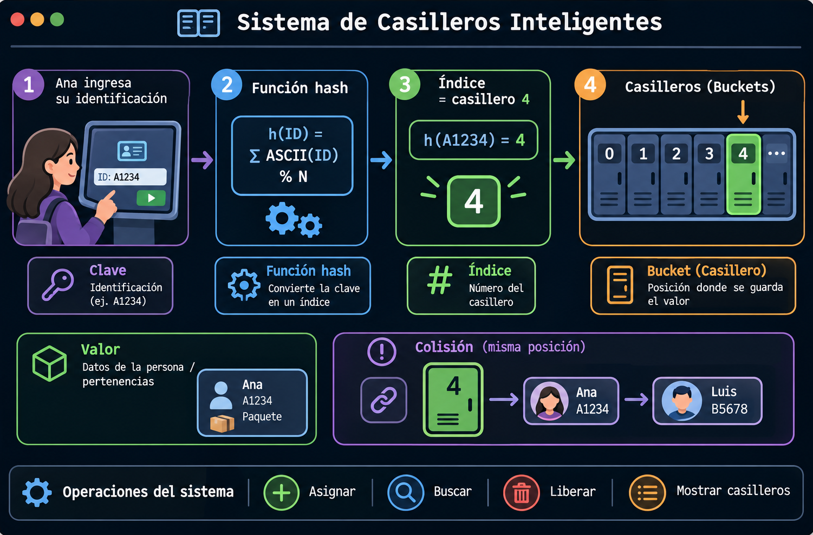
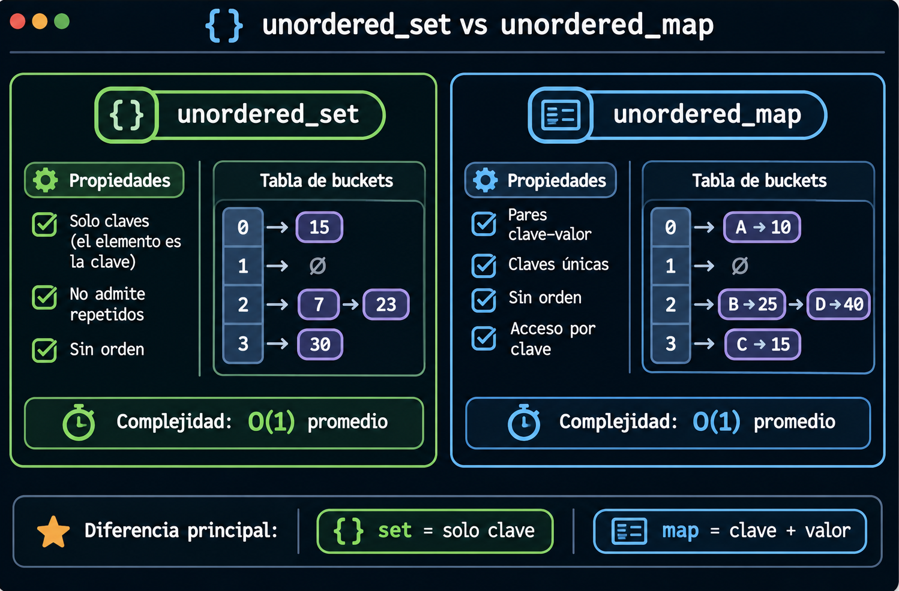

# Tablas Hash
 
## Introducción
 
En esta práctica se estudiará las tablas hash y su funcionamiento, el manejo de colisiones y su aplicación mediante los contenedores `std::unordered_set` y `std::unordered_map` de C++.
 
## 1. Tabla hash
 
Una **tabla hash** es una estructura que asocia **claves** con **valores**. En lugar de recorrer los elementos uno por uno, aplica una función hash a la clave para obtener un **índice**, que indica la posición de la tabla donde se almacenará el dato.
 
### Conceptos clave
 
- **Clave:** dato que identifica de forma única a un elemento (por ejemplo, un número de identificación).
- **Valor:** información asociada a la clave (por ejemplo, los datos de una persona).
- **Función hash:** fórmula que transforma la clave en un número entero dentro del rango de la tabla. Una forma sencilla es sumar los valores ASCII de los caracteres de la clave y aplicar el módulo del tamaño de la tabla: `índice = suma ASCII % tamaño`.
- **Índice (hash):** resultado de la función hash; indica en qué posición se guardará el elemento.
- **Buckets:** espacios o casillas de la tabla donde se almacenan los elementos.

 

### Complejidad
    
La función hash indica directamente en qué índice buscar, insertar o eliminar, sin recorrer toda la estructura. Por eso estas operaciones tienen una complejidad promedio de **O(1)**, es decir, **tiempo constante**.
 
| Operación   | Caso promedio | Peor caso |
| ----------- | ------------- | --------- |
| Insertar    | O(1)          | O(n)      |
| Buscar      | O(1)          | O(n)      |
| Eliminar    | O(1)          | O(n)      |
 
> 💡 El peor caso O(n) ocurre cuando muchas claves generan el mismo índice y se acumulan en un solo bucket. Una buena función hash y un tamaño de tabla adecuado reducen este problema.
 
## 2. Colisiones
 
Una **colisión** ocurre cuando dos claves distintas obtienen el mismo índice al aplicar la función hash, es decir, dos datos deben guardarse en la misma posición de la tabla.
 
### Solución: encadenamiento separado (hash abierto)
 
La técnica de **encadenamiento separado**, también llamada **hash abierto**, consiste en que cada bucket contenga una **lista enlazada**. Cuando ocurre una colisión, el nuevo elemento simplemente se agrega a la lista de ese índice, de modo que varios datos pueden convivir en la misma posición.

 
## 3. Ejemplo práctico: sistema de casilleros inteligentes
 
Imaginemos un edificio con casilleros inteligentes. Cuando una persona llega a guardar sus pertenencias, ingresa su **identificación** en una pantalla; el sistema aplica la función hash sobre esa identificación y le indica **qué casillero le corresponde**. Cuando regresa, vuelve a ingresar su identificación y el sistema calcula el mismo índice para encontrar su casillero de inmediato, sin revisar uno por uno.

### Operaciones del sistema
 
| Operación           | Descripción                                                              |
| ------------------- | ------------------------------------------------------------------------ |
| Asignar casillero   | Calcula el hash de la identificación y guarda a la persona en ese índice. |
| Buscar casillero    | Calcula el hash de la identificación y localiza el casillero asignado.   |
| Liberar casillero   | Elimina el registro de la persona de su casillero.                       |
| Mostrar casilleros  | Recorre la tabla y muestra los casilleros ocupados.                      |
 
## 4. Contenedores `std::unordered_set` y `std::unordered_map` en C++
 
La Biblioteca Estándar de C++ (STL) ofrece los contenedores `std::unordered_set` y `std::unordered_map`, que están implementados internamente mediante **tablas hash**. A diferencia de `std::set` y `std::map` (árboles rojo-negro, O(log n)), estos contenedores **no mantienen sus elementos ordenados**, pero permiten realizar búsqueda, inserción y eliminación en **O(1)** en promedio.
 
### Comparación entre `std::unordered_set` y `std::unordered_map`
 

### Métodos básicos
 
| Método              | Funcionalidad                                         |
| ------------------- | ----------------------------------------------------- |
| `insert()`          | Inserta un elemento nuevo.                            |
| `find()`            | Busca un elemento o una clave.                        |
| `erase()`           | Elimina un elemento o una clave.                      |
| `count()`           | Indica si un elemento o clave existe (0 o 1).         |
| `size()`            | Obtiene la cantidad de elementos.                     |
| `begin()` / `end()` | Permiten recorrer el contenedor mediante iteradores.  |
| `clear()`           | Elimina todos los elementos.                          |
 
### Uso con estructuras (`struct`)
 
En la práctica no se guardan solo datos simples, sino estructuras con varios campos (por ejemplo, un `struct Casillero` con identificación, nombre y número de casillero). Esto cambia la forma de usar cada contenedor:
 
- **`std::unordered_map`:** la clave es un dato simple, como la **identificación** (`string`), y el valor es el `struct` completo. Como la clave es un tipo que la STL ya sabe "hashear", **no es necesario crear una función hash**.
- **`std::unordered_set`:** se guarda el `struct` completo, pero el contenedor no sabe qué campo usar como clave. Por eso se deben definir dos cosas:
  1. **Una función hash propia:** un `struct` adicional (por ejemplo, `CasilleroHash`) que indique de qué campo se obtiene el hash. Se usa la función `std::hash`, que ya viene en la librería, indicando el tipo de dato y el campo, por ejemplo `std::hash<string>()(c.identificacion)`. No se necesitan fórmulas adicionales, basta con el campo clave.
  2. **Un criterio de igualdad:** el operador `==` que indique cuándo dos estructuras son iguales (comparando su identificación). Es equivalente a la función booleana comparadora usada en `std::set`, pero aquí sirve para saber si un elemento ya existe.
  Al declarar el contenedor se indica el tipo y la función hash: `unordered_set<Casillero, CasilleroHash>`.
> 💡 Si la clave estuviera dentro del `struct` en un `unordered_map`, también habría que pasar la función hash como tercer parámetro. Por eso se recomienda usar como clave un campo simple que no se repita.
 
### Buenas prácticas
 
- Elegir como clave un dato **único** que no se repita (identificación, código, carné). Un dato como la letra inicial de una palabra se repite y no sirve como clave.
- Preferir `unordered_map` con una clave simple cuando se necesita asociar datos a un identificador; reservar `unordered_set` para verificar existencia de elementos.
- Usar `unordered_set` / `unordered_map` cuando importa la velocidad de búsqueda y no el orden; si se necesitan los datos ordenados, usar `set` / `map`.
## 5. Ejemplo
  
[Casilleros con Tabla Hash Manual](https://github.com/meaguilar/PED-Clases/blob/main/EjerciciosLaboratorios/Laboratorio-6/casilleros_hash_manual.cc)  
[Casilleros usando UNORDERED_SET](https://github.com/meaguilar/PED-Clases/blob/main/EjerciciosLaboratorios/Laboratorio-6/casilleros_unordered_set.cc)  
[Casilleros usando UNORDERED_MAP](https://github.com/meaguilar/PED-Clases/blob/main/EjerciciosLaboratorios/Laboratorio-6/casilleros_unordered_map.cc)
 
## 6. Enlaces adicionales
 
- [Visualgo — Hash Table](https://visualgo.net/en/hashtable): visualización interactiva de inserciones, búsquedas y colisiones.
- [Open Hashing Visualization — University of San Francisco](https://www.cs.usfca.edu/~galles/visualization/OpenHash.html): permite observar el encadenamiento separado.
- [cppreference — std::unordered_set](https://en.cppreference.com/w/cpp/container/unordered_set): referencia del contenedor y sus métodos.
- [cppreference — std::unordered_map](https://en.cppreference.com/w/cpp/container/unordered_map): referencia del contenedor y sus métodos.